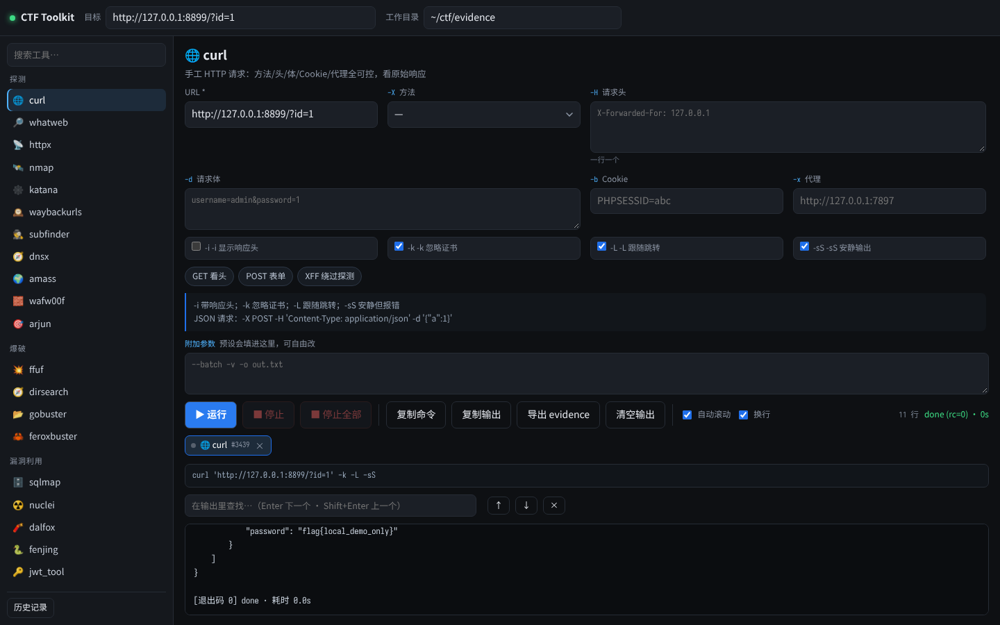
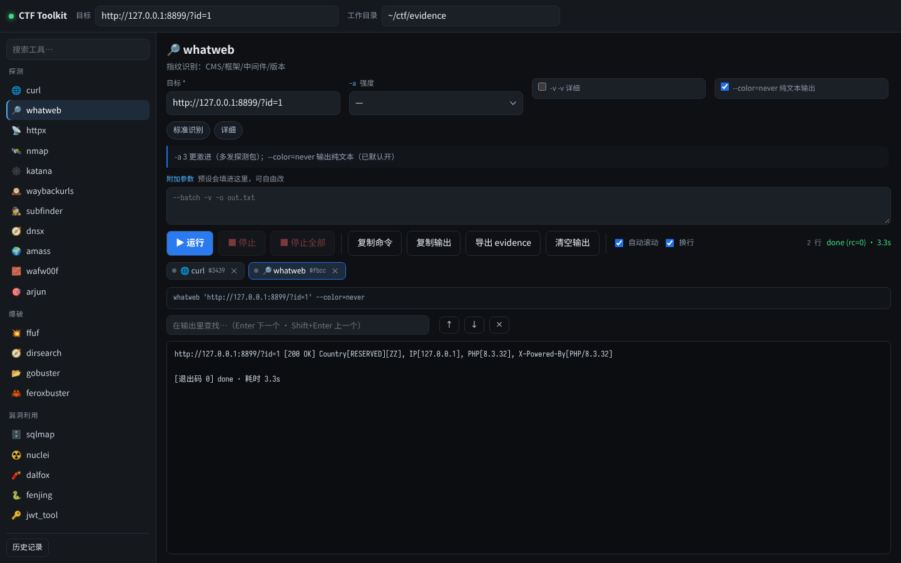
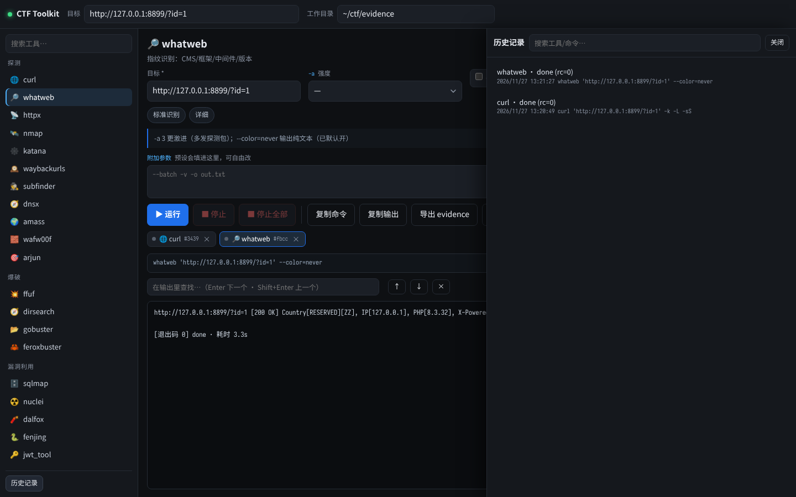
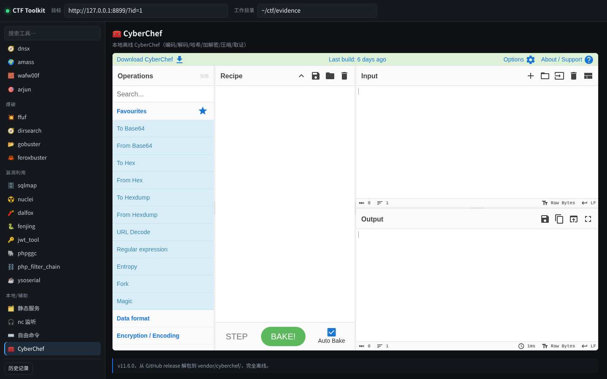

# CTF Toolkit

本文件是本仓库（My_config）里 CTF 工具箱的说明，路径均相对仓库根目录；dotfiles 部分见 [README](../README.md)。

本地 Web/CTF 工具台：把分散在 `~/.local/bin`、`~/ctf/tools`、Docker 镜像里的命令行工具收进一个界面。左栏选工具 → 填参数 → 运行 → 输出实时流回页面，命令行可一键复制回终端。提供 Tauri 桌面窗口与纯浏览器两种模式。

## 特性

- 纯本地：仅监听 `127.0.0.1`。浏览器模式零第三方依赖（Python 标准库 + `tomllib`），桌面模式使用系统 WebView。
- 27 个工具 / 4 个分类，专注 Web，均带预设（列库、目录爆破、JWT 攻击、SSTI、PHP/Java 反序列化等）。
- 顶部「目标」框自动填充主字段（`{{TARGET}}` 占位符）；逗号/换行分隔可一次运行多个目标。
- 多任务并行：每个 run 一个标签页，独立轮询/缓冲；关闭运行中的标签即停止；历史记录可回放。
- 输出实时流式显示，支持停止、停止全部、复制、导出到 `~/ctf/evidence/`、查找高亮。
- 内置离线 CyberChef 与常用字典。
- `tools.toml` 热重载：存盘即生效，无需重启。

## 界面

主界面：顶部「目标」自动填充主字段，中间是工具参数与命令预览，输出实时流回底部。



多任务：每个 run 一个标签，独立轮询与缓冲；点 × 关闭，运行中的会先停止。



历史记录：按工具/命令搜索，点一条即回放为标签。



内嵌的离线 CyberChef：编解码、哈希、加解密，不联网。



## 安装与启动

### 桌面模式（推荐）

```bash
npm install                     # 安装 @tauri-apps/cli（仅构建期）
npx tauri build                 # 生成 src-tauri/target/release/ctf-toolkit
bash scripts/install-desktop.sh # 软链到 ~/.local/bin + 应用菜单入口
```

由应用菜单或 `ctf-toolkit` 启动。壳自动启动 Python 后端（内核分配端口）；关闭窗口、Ctrl-C 或 kill 均会回收后端。指向其他仓库可用 `TOOLKIT_ROOT=/path/to/repo`。单实例锁防止重复启动。

构建依赖：Rust ≥ 1.77、Node.js、webkit2gtk-4.1 / gtk3 / libsoup3。

### 浏览器模式

```bash
bash scripts/fetch-vendor.sh   # 拉取字典与离线 CyberChef（约 80MB，不进 git）

toolkit                        # 启动服务并打开浏览器（默认 http://127.0.0.1:8787/）
toolkit --port 9000            # 指定端口
toolkit --no-browser           # 仅启动服务
```

换机器/新克隆：`ln -sf "$PWD/bin/toolkit" ~/.local/bin/toolkit`。

## 测试

```bash
python3 -m unittest discover -s selftest -t .   # 单元测试
python3 selftest/smoke.py                       # 端到端链路（本地 PHP 靶站）
```

CI（GitHub Actions）在每次 push 时运行单元测试、JS 语法检查与 Rust 格式检查。dotfiles 侧的用例（`test/cases/`）见 [README 的「测试」一节](../README.md#测试)。

## 工具清单

| 分类 | 工具 | 定位 |
|---|---|---|
| 探测 | `curl` `whatweb` `httpx` `nmap` `katana` `waybackurls` `subfinder` `dnsx` `amass` `wafw00f` `arjun` | 手工请求、指纹、存活探测、爬站、历史 URL、子域资产、WAF 识别、隐藏参数 |
| 爆破 | `ffuf` `dirsearch` `gobuster` `feroxbuster` | 目录 / 子域 / 参数 |
| 漏洞利用 | `sqlmap` `nuclei` `dalfox` `fenjing` `jwt_tool` `phpggc` `php_filter_chain` `ysoserial` | SQLi、模板扫描、XSS、SSTI、JWT、PHP/Java 反序列化 |
| 本地/辅助 | `静态服务` `nc 监听` `自由命令` `CyberChef` | 起站、收 shell、任意命令、编解码 |

工具本体不迁移，`tools.toml` 仅记录调用方式。

## 添加工具

在 `tools.toml` 追加条目即可，无需改代码：

```toml
[[tool]]
id = "nikto"
name = "nikto"
category = "vuln"          # recon / brute / vuln / local
icon = "🕵️"
desc = "经典 Web 扫描器"
notes = "-Tuning 调整测试项；-ssl 走 https"
cmd = ["nikto"]
fields = [
  { flag = "-h", label = "目标", kind = "text", ph = "{{TARGET}}", tgt = true },
  { flag = "-Tuning", label = "测试项", kind = "text", ph = "123b" },
  { flag = "-ssl", label = "-ssl", kind = "bool" },
]
presets = [ { label = "常规扫描", args = "-h {{TARGET}} -Tuning 123b" } ]
```

校验语法后刷新页面即生效（热重载）：

```bash
python3 -c "import tomllib;d=tomllib.load(open('tools.toml','rb'));print(len(d['tool']),'tools ok')"
```

字段说明：

- `kind`：`text` / `textarea` / `select`(`options`) / `bool`(`default="1"` 勾上) / `combo`(`options_from="wordlists"`) / `number`。
- `flag` 留空 = 位置参数；`repeat = true` = 一行一个参数；`tgt = true` = 顶部目标自动填充（一个工具只标一个）。
- 管道/重定向用 `mode = "shell"` + 一个 `raw = true` 字段。
- `ok_codes = [0, 64]` 指定视为成功的退出码；`strip_proxy = true` 丢弃环境代理（内置 httpx 的 Python 工具用）。

完整 schema 见 `tools.toml` 文件头注释。

## 目录

```
toolkit.py        # 服务端：注册表加载、命令拼装、进程管理、HTTP/API
tools.toml        # 工具注册表
web/              # 前端（原生 JS，无构建步骤）
wordlists/        # 字典（gitignored，fetch-vendor.sh 拉取）
vendor/cyberchef/ # 离线 CyberChef（gitignored）
scripts/          # fetch-vendor.sh / install-desktop.sh
src-tauri/        # Tauri 桌面壳
selftest/         # 自测
bin/toolkit       # 启动器
```

运行日志落在 `~/.local/state/ctf-toolkit/logs/`，导出复制到 `~/ctf/evidence/<工具>/`。

## 说明

- **安全**：服务仅绑定 `127.0.0.1`（绑定其他地址需显式 `--allow-remote`）；POST 要求 `X-Requested-By: toolkit` 头并校验 `Origin`，防止跨站调用本地接口。请勿对外暴露。
- **仅限授权目标**。
- **热重载**：`tools.toml` 按 mtime 重读；解析失败则告警并继续使用旧配置。
- **状态清理**：运行日志保留最近 200 个；单个 run 的磁盘日志上限 32MB（超限只留尾部 8MB）；`history.jsonl` 超 400 条裁剪到 300；内存最多 40 个 run；同时最多 20 个进程在跑。
- **桌面壳**：窗口加载后端回环端口，安全模型与浏览器模式一致；壳只负责进程生命周期。二进制搬出仓库时从可执行文件目录向上查找 `tools.toml`，找不到用 `TOOLKIT_ROOT` 指定。

## 已知限制

| 事项 | 现状 |
|---|---|
| 无鉴权 | 仅靠回环 + 自定义头；同一台机器上的本地进程均可调用 API |
| 输出仅本地 | 未自动汇总命中结果成 writeup，导出为原始日志 |
| 无 worker 复用 | 多目标起多个独立进程，不共享 worker |
